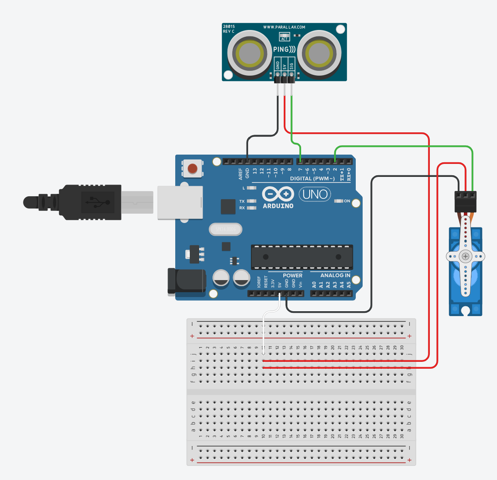

# Virtual Mechatronics Smart Barrier

An automated gate system built using an Arduino microcontroller, an ultrasonic distance sensor, and a servo motor. This project simulates a real-world parking garage barrier or automated security gate.

---

## 📺 Project Simulation

https://github.com/user-attachments/assets/4213ebc2-b900-433c-b6c0-2cfd9ebc2383

---

## 🛠️ How It Works

The system continuously monitors the distance of objects in front of it using a Parallax PING))) ultrasonic sensor. 
* When an object approaches within a range of **100cm to 250cm**, the Arduino sends a signal to the servo motor to rotate 90 degrees (opening the barrier).
* If no object is detected within that specific range, the servo returns to 0 degrees (closing the barrier).

### Components Used (Simulated):
* **Microcontroller:** Arduino Uno R3
* **Actuator:** Micro Servo Motor (PWM Controlled)
* **Sensor:** Parallax PING))) Ultrasonic Distance Sensor
* **Prototyping:** Half-sized Breadboard

---

## 🧠 What I Learned

* **Embedded C++ Basics:** Writing modular code, defining constants, and structuring the main execution loop.
* **Sensor Interfacing:** Managing a single-signal-pin sensor by dynamically changing the `pinMode` between `OUTPUT` (to trigger the sonic pulse) and `INPUT` (to listen for the echo).
* **Pulse Width Modulation (PWM):** Controlling a servo motor's exact physical position using digital timing signals via the standard Arduino `Servo.h` library.
* **Troubleshooting & Calibration:** Adjusting code and timing logic to align physical/simulated components accurately.
